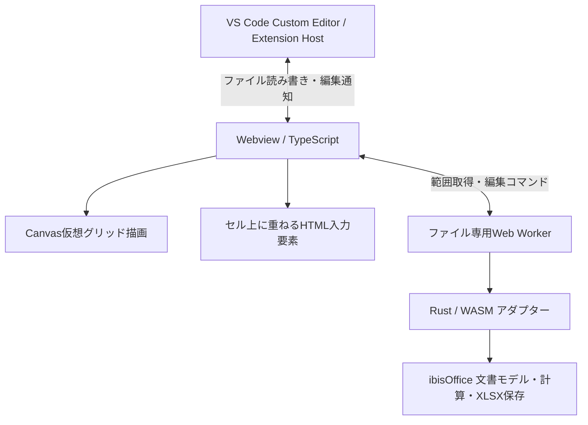

# VS Code向け軽量XLSXエディタ 仕様書

- ステータス：設計途中（2026-11-05時点）
- 目的：Codexへの実装引き継ぎに向けた合意事項の整理
- 優先順位：軽量性、既存XLSXの安全性、VS Codeとの自然な統合

## 1. 製品概要

VS Code上で `.xlsx` を直接閲覧・編集できる軽量なCustom Editor拡張機能を開発する。Rust製ibisOfficeのUI非依存エンジンを可能な範囲で再利用し、Webview上のCanvasで表を描画する。公開先はGitHubリポジトリとし、VS Code Marketplaceへの公開は当面対象外とする。

### 対象範囲

- 対応ファイル形式：`.xlsx`（初期版）
- 対象環境：VS Codeデスクトップ（Web版対応は未決定）
- 主な用途：既存Excelファイルの閲覧、セル編集、基本書式変更、表の操作
- 対象外：Excelの完全互換、独自のリボンUI、グラフ・画像・ピボット・マクロ等の高度な編集

## 2. アーキテクチャ

- 各XLSXファイルのWebviewごとに独立したWorkerとWASMインスタンスを持つ。
- Workerはファイルを閉じたときに終了し、保持メモリを解放する。
- Canvasは表示範囲とその周辺のみ描画する。セルデータも表示範囲に限定してRust側から取得する。
- ワークブック本体はRust/WASM側に保持する。表示範囲取得はJS側のデータ複製を削減するが、ワークブック本体のメモリ使用量は別途考慮する。
- Rust/WASMの `wasm32-unknown-unknown` ビルド、およびVS Code WebviewのCSP下でのWorker起動は未検証であり、最初に技術スパイクを行う。

## 3. ファイルの起動と保存

### 起動

- `.xlsx` をクリックすると、原則として専用エディタで開く。
- VS Code Custom Editorの `priority: "default"` を使用する方針。
- 他の拡張機能やユーザー設定との競合時はVS Code側の選択動作に従う。

### 保存

- VS Codeの通常の保存操作（Cmd/Ctrl+S）に対応する。
- ibisOfficeの `Source::save()` を使用し、元のXLSX構造と未編集要素を可能な限り保持する。
- 拡張ホストがVS CodeのCustom Editor保存・バックアップ・編集イベントを適切に実装する。
- 保存エラー時に元ファイルを破損させないこと。必要に応じて一時出力・検証後の書き込みを行う。
- 未対応機能を安全に保持できる場合のみ編集可能とし、保持が保証できない場合は読み取り専用にする。
- 元ファイルと保存後ファイルの往復テストで保持性を検証する。`Source::save()` の使用だけで完全保持を保証したものとはみなさない。

## 4. セル表示・入力

- Canvasでセルを描画する。DOMに全セルを展開しない。
- 選択セル上にHTML入力要素を重ねて直接編集する。
- ダブルクリック、F2、文字入力による編集開始を想定する。
- 日本語IMEの変換確定とセル編集確定を区別する。
- 数式バーは初期版では表示専用とする。
- 複数セルの範囲選択に対応する。

## 5. UI

- 上部：コンパクトな1段の書式ツールバーと表示専用の数式バー。
- 中央：Canvasによるセル表示・編集領域。
- 下部：シートタブとズーム操作。
- Excel風のリボンUIは採用しない。
- 右クリックメニューで行・列・シート等の操作を提供する。
- VS Codeのテーマとの調和を図る。

## 6. 書式

基本書式の**表示と変更**に対応する。

- 太字
- 文字色
- 背景色
- 文字揃え
- 数値形式

書式変更はRust側の編集履歴に記録する。具体的な数値形式の種類や書式の適用範囲は実装時に定義する。

## 7. 数式

- ibisOfficeの `ibis-calc` の再利用を目指す。
- セル編集確定時に依存する数式を自動再計算する。
- 計算はWeb Worker内で実行し、UIスレッドのブロックを避ける。
- 未対応関数・計算失敗時も元の数式を保持し、計算できないことを明示する。
- 既存の数式やキャッシュ値の保存互換性を検証する。

## 8. Undo / Redo

- Rust/WASM側で編集履歴を管理する。
- セルの値・数式・書式、行列操作、シート操作、並べ替え等の変更を対象とする。
- 原則として差分／編集コマンドを記録し、ブック全体のスナップショットを避ける。
- VS Code Custom Editorの編集イベントとUndo/Redo APIに連携する。
- ibisOffice既存コマンドの逆操作対応は要検証。

## 9. コピー＆ペースト

- 外部アプリとの受け渡しにはTSV形式を使用する。
- 拡張機能内のコピーではセル値、数式、基本書式などの内部情報を保持する。
- 内部情報は実際のクリップボード内容と照合し、外部コピー後に古い内部データを貼り付けない。
- 数式の相対参照調整の正確な対応範囲は技術検証で決定する。

## 10. 行・列操作

- 行・列の挿入
- 行・列の削除
- 行の高さ変更、列の幅変更
- 右クリックメニューから実行
- 数式参照・結合セルなどの整合性を維持できない操作は実行させない。

## 11. シート管理

- シートの切り替え
- 追加・削除・名前変更・並べ替え
- 下部タブのドラッグ操作と右クリックメニューを想定
- シート名変更・削除時の数式参照更新はエンジン側の対応を検証する。

## 12. 検索・置換

- 検索範囲を「現在のシート」「ブック全体」から選択できる。
- 検索結果のセルへ移動する。
- 単一置換とすべて置換に対応する。
- 初期版の置換対象は文字列セルのみとし、数式セルを誤って破壊しない。
- 検索処理はRust/WASM側で実施し、UIには結果を返す。

## 13. 並べ替え・フィルター

- 選択範囲の指定列による昇順・降順ソート。
- 列ごとの値による絞り込み。
- 数式参照・結合セルを安全に扱えないソートは実行しない。
- フィルター表示状態とXLSX内のフィルター定義保存の対応範囲は別途検証する。

## 14. スクロール・ズーム

- ブラウザ標準スクロールを利用する。
- ズーム範囲は50〜200%。
- Canvasの表示範囲のみを再描画する。
- Excelの最大行数をそのまま巨大なHTML要素の高さにせず、論理座標とスクロール位置の変換を実装する。

## 15. 大規模ファイル・性能

- XLSXファイルのバイトサイズによる一律の上限は設けない。
- 読み込み中は進捗／処理中表示を行い、高負荷時に警告する。
- ZIP展開量やメモリ使用量には安全上限を設ける。
- Webview表示・セル入力の応答性を優先する。
- 性能目標値は技術スパイク後に実測に基づいて確定する。

## 16. ibisOfficeの利用方針とライセンス

候補リポジトリ：<https://github.com/ibisjp/ibis-office>

- `ibis-calc`：数式計算
- `ibis-doc-model`：ワークブックモデル・編集操作
- `ibis-ooxml`：OOXML処理
- `ibis-pptx`：名称に反してXLSX読み書きAPIを含む可能性があるため検証対象
- `ibis-office-app`：GPUI依存のため原則として直接依存しない

依存方法は検証済みコミットSHAへのCargo Git依存を第一候補とし、ワークスペース依存の問題がある場合はGit submodule等を検討する。

上流のライセンスはAGPL-3.0-onlyとして扱い、コードの再利用・配布条件、著作権表示、NOTICEの追加表示要件（`Powered by ibisOffice` と公式GitHubへのリンク）、商標ガイドラインを遵守する。公開リポジトリのライセンス設計は実際の依存・配布形態に照らして最終確認する。

## 17. 未決定事項・検証課題

1. **ウィンドウ枠の固定**：先頭行・先頭列・任意位置の固定を採用するか。直前の提案では「基本的な枠の固定」を推奨したが、ユーザーの決定はまだない。
2. ibisOffice各crateのWASMコンパイル可否、Webview CSP下のWorker起動。
3. `Source::save()` の保持対象・未対応要素の検出・安全な保存判定。
4. 数式依存関係の再計算、相対参照のコピー、構造変更時の参照更新。
5. Undo/Redoの逆操作とVS Code Custom Editor APIとの整合。
6. フィルター定義の永続化と検索・置換・ソートの詳細仕様。
7. 実測によるメモリ・起動時間・スクロール・入力遅延の性能基準。
8. テスト対象OS、最小VS Codeバージョン、ビルド・配布手順。

## 18. Codexへの実装上の注意

- この文書は**確定した製品仕様と未検証の実装仮説**を併記している。仮説を実装可能と決めつけない。
- まず最小の技術スパイクで「XLSX読込 → Canvas表示 → セル編集 → 自動再計算 → 安全な保存」を通す。
- 機能追加よりも、未編集データの保持、破損防止、Undo/Redo整合性、メモリ使用量の検証を優先する。
- 未対応操作は黙って実行せず、明示的に無効化またはエラーにする。
